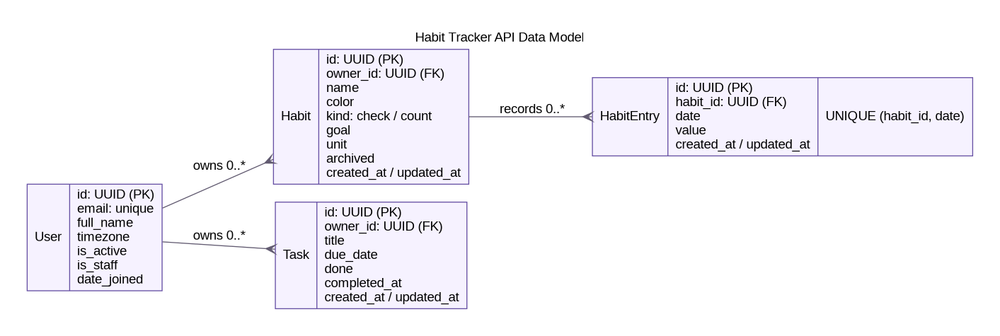

# Habit Tracker API

Production-oriented Django REST API for the existing Flutter habit tracker and a
future React client. The API uses camel-case field names where they match the
mobile models (`dueDate`, `createdAt`, `habitId`) and keeps all user data isolated
by the JWT identity.

## Data model



The editable Graphviz source is
[`docs/data-model.dot`](docs/data-model.dot), and an SVG version is available at
[`docs/data-model.svg`](docs/data-model.svg).

## Run locally

Python 3.12 or newer is required.

```bash
cd backend
python -m venv .venv
. .venv/bin/activate
python -m pip install -r requirements-dev.txt
python manage.py migrate
python manage.py createsuperuser
python manage.py runserver
```

Local development defaults to SQLite. Open:

- API documentation: <http://127.0.0.1:8000/api/docs/>
- OpenAPI schema: <http://127.0.0.1:8000/api/schema/>
- Admin: <http://127.0.0.1:8000/admin/>
- Liveness: <http://127.0.0.1:8000/health/live/>
- Database readiness: <http://127.0.0.1:8000/health/ready/>

## Docker and PostgreSQL

Copy and edit the production environment template first:

```bash
cp backend/.env.example backend/.env
python -c "import secrets; print(secrets.token_urlsafe(64))"
docker compose up --build -d
docker compose exec api python manage.py createsuperuser
```

Generate separate random values for `DJANGO_SECRET_KEY`, `JWT_SIGNING_KEY`, and
the database password. The Compose port listens on `127.0.0.1` by default; put a
TLS reverse proxy in front of it. Do not expose Gunicorn directly to the public
internet.

The application reads any Django-supported connection configured by
`DATABASE_URL`. PostgreSQL is the production default in `compose.yaml`; SQLite is
only the zero-setup development default.

For a multi-replica deployment, set `RUN_MIGRATIONS=false` on application
replicas and run this once as a release job:

```bash
python manage.py migrate --noinput
```

## API v1

All collection endpoints are paginated. Send access tokens as
`Authorization: Bearer <access-token>`.

| Method | Endpoint | Purpose |
| --- | --- | --- |
| `POST` | `/api/v1/auth/register/` | Create an account |
| `POST` | `/api/v1/auth/login/` | Get access and refresh tokens |
| `POST` | `/api/v1/auth/refresh/` | Rotate a refresh token |
| `POST` | `/api/v1/auth/logout/` | Blacklist a refresh token |
| `GET/PATCH` | `/api/v1/auth/me/` | Read or update the current profile |
| `GET/POST` | `/api/v1/habits/` | List or create habits |
| `GET/PATCH/DELETE` | `/api/v1/habits/{id}/` | Manage one habit |
| `POST` | `/api/v1/habits/{id}/record/` | Upsert a dated value; value `0` deletes it |
| CRUD | `/api/v1/habit-entries/` | Synchronize and query daily entries |
| CRUD | `/api/v1/tasks/` | Manage one-off tasks |
| `GET` | `/api/v1/dashboard/?date=YYYY-MM-DD` | Fetch the Today-screen snapshot |

Useful entry filters are `habitId`, `dateFrom`, and `dateTo`. Task filters include
`done`, `dueFrom`, `dueTo`, and `overdue`. The interactive documentation contains
the complete request and response schemas.

Example:

```bash
curl -X POST http://127.0.0.1:8000/api/v1/auth/login/ \
  -H 'Content-Type: application/json' \
  -d '{"email":"person@example.com","password":"your-password"}'

curl -X POST http://127.0.0.1:8000/api/v1/habits/HABIT_UUID/record/ \
  -H 'Authorization: Bearer ACCESS_TOKEN' \
  -H 'Content-Type: application/json' \
  -d '{"date":"2026-10-17","value":1}'
```

The Flutter `Habit.log` map corresponds to `HabitEntry` rows keyed by `date`.
`TaskItem.dueDate` and `TaskItem.done` map directly to the task response.

## Security baseline

- UUID public IDs and owner-scoped querysets prevent cross-account object access.
- Argon2 is the primary password hasher; Django's password validators run at
  registration.
- Access tokens are short lived. Refresh tokens rotate and are blacklisted after
  rotation or logout.
- Login, registration, anonymous, and authenticated traffic have separate
  throttles.
- CORS uses an explicit origin allowlist. Debug mode, hosts, HTTPS redirects,
  secure cookies, HSTS, and proxy trust are environment controlled.
- Production startup fails when `DJANGO_SECRET_KEY`, `DATABASE_URL`, or allowed
  hosts are missing.
- The container runs as a non-root user with a read-only filesystem, dropped
  Linux capabilities, a health check, and graceful Gunicorn shutdown.
- API validation blocks future habit entries, duplicate daily entries, invalid
  timezones, and client-supplied ownership.
- Error responses include a request ID without exposing exception internals.

No framework configuration can guarantee complete security. Before launch,
terminate TLS at a maintained proxy/load balancer, store secrets in a secret
manager, restrict database networking, configure backups and monitoring, scan
the built image, and arrange dependency and application security reviews.

## Quality checks

```bash
cd backend
ruff check .
python manage.py makemigrations --check --dry-run
python manage.py spectacular --file /tmp/openapi.yaml --validate
coverage run manage.py test
coverage report
DJANGO_ENV=production \
DJANGO_SECRET_KEY='replace-with-a-long-test-secret' \
DJANGO_ALLOWED_HOSTS='api.example.test' \
DATABASE_URL='sqlite:////tmp/production-check.sqlite3' \
python manage.py check --deploy --fail-level WARNING
```
